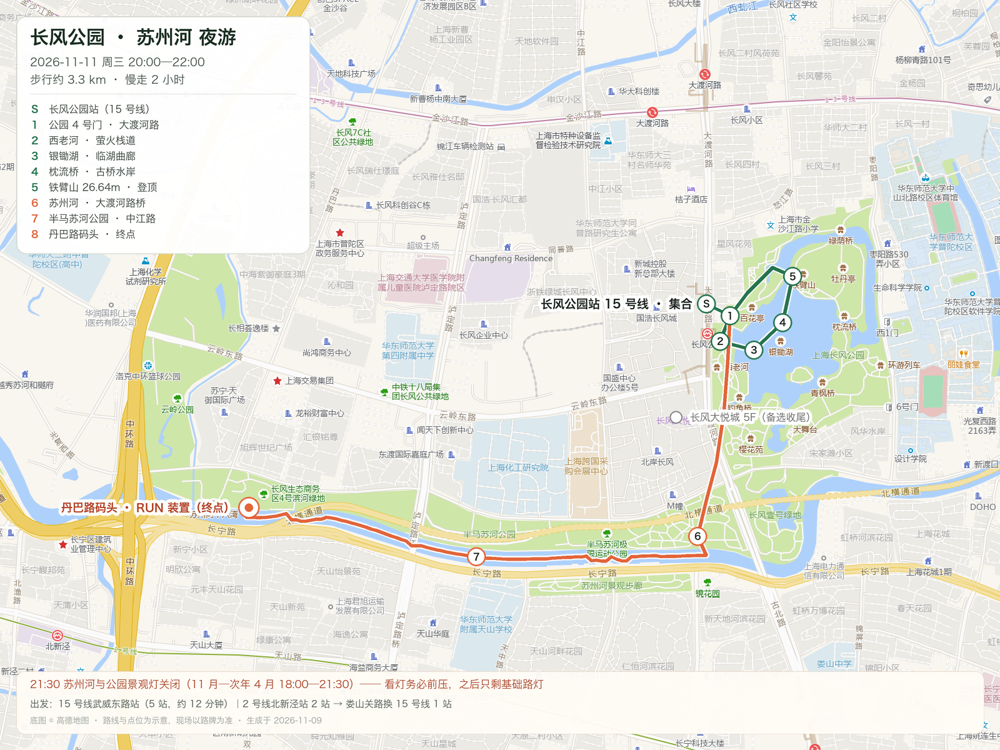

# 旅行攻略助手 · travel-guide

<p align="center">
  <a href="LICENSE"></a>
  
  
  
</p>

> 说一句「周三晚上两小时，想看点灯」——拿到一份**小时级、可核验、能直接发群**的攻略。

**它是什么**：一个跑在 [DeepSeek Harness](https://github.com/deepseek-ai/deepseek-harness) 里的旅行攻略工作区——两个技能（`travel-guide` 负责取材、偏好、路线图与分享；`trip-planner-cn` 是境内规划内核）、一组取材与路线脚本、一份真实示例和一份口味档案。

输入一句人话，输出一组**留在你本地**的文件：`行程.md`、`路线图.html`（每个点带高德深链）、750px `攻略长图.png`、`分享文案.md`。不发帖，也不自动发消息。

它不是「AI 写游记」的提示词，而是一套**装了刹车的工作流**：模型记忆只负责「哪里值得去」，票价、开放时间、营业状态这些会变的事实，必须先拿到证据才准写。旅游攻略最容易翻车的地方就那么几个——票价编造、开放时间记错、路线走回头路、发到群里链接打不开——这里用取材分工、证据分级、脚本自查和本地渲染，把它们逐个堵住。

<p align="center">
  
  
</p>
<p align="center"><sub>左：750×1623 分享长图，微信 / QQ 直发 · 右：1600×1200 路线图，高德底图 + 编号点位</sub></p>

这两张图都出自 [行程/2026-11-11-长风公园-苏州河/](行程/2026-11-11-长风公园-苏州河/)：一条真实排过的 2 小时夜游路线，已脱敏（去掉居住区域、人物称呼和账号信息），只保留公共路线。

## 你会拿到什么

一次完整输出（示例见上，点链接直接看）：

- **[行程.md](行程/2026-11-11-长风公园-苏州河/行程.md)**：集合点、逐段时间轴、吃喝、避坑、预算，每条线都带 Plan B。
- **[路线图](行程/2026-11-11-长风公园-苏州河/路线图.html)**：PNG 直接发群，HTML 每段可点高德深链；默认零 Key。
- **[攻略长图](行程/2026-11-11-长风公园-苏州河/攻略长图.png)**：750px，微信 / QQ 直发，不用对方点链接。
- **[分享文案](行程/2026-11-11-长风公园-苏州河/分享文案.md)**：发群 / 朋友圈 / 约人三版，复制就能用。
- **[取材表](行程/2026-11-11-长风公园-苏州河/素材/取材-平台.md)**：平台信息逐条标来源、发布时间和「采纳了什么」，没核实的写「未查到」。

多日行程还会多几样：2—3 条路线骨架先选后排、高铁 / 机票 / 自驾逐段比较与预订深链、按街区筛的住宿、预算汇总和预订清单；成品可以渲染成七套主题设计页（插画 / 黏土 / 夜航 / 玻璃 / 手账 / Zine / 闪屏），也能导出 KML 和日历。

- **适合**：周末 / 小长假想认真排一次、带家人朋友出行、最后要把攻略发到群里的人。
- **不适合**：想一键生成、不核对就出发的人——这套流程会逼你确认票价、开放时间和营业状态。

## 快速开始

### 1. 当成工作区用（推荐）

```bash
git clone https://github.com/2022124030jc/travel-guide.git
```

用 DeepSeek Harness 打开这个目录作为工作区——`.dsh/skills/` 下的两个技能会被自动加载，然后直接说需求：

- “周三晚上 8 点到 10 点，长风公园附近，两个人想看灯，帮我排一条路线”
- “11 月中旬去成都 4 天，两个人，人均 3000，帮我做攻略”
- “把这份攻略做成图发我微信”

第一次用先把 [偏好/我的偏好.md](偏好/我的偏好.md) 填一下：从哪出发、几个人、预算、必须去 / 必须不去。空着也能跑，但会先问你四个问题。

### 2. 只跑脚本

取材与路线脚本只用 Python 标准库（3.9+），不用 `pip install`：

```bash
# 可选自检：抖音 / 小红书服务 / 高德 Key / OSRM 四项
# 高德 Key 未配置会显示 NOKEY，属于可选项，不影响零 Key 出图
python3 工具/doctor.py

# 路线图：零 Key、不联网；不带 --from-json 时用脚本内置的北京样例演示
python3 .dsh/skills/travel-guide/scripts/amap_route.py \
  --out 路线图.svg --html 路线图.html --links 链接.json --title "路线图示例"

# 抖音匿名取材；小红书走本地服务，见 工具/README.md
python3 .dsh/skills/travel-guide/scripts/douyin_pick.py \
  https://www.douyin.com/shipin/<id> -o 素材/dy.json
```

真实行程用 `--from-json 点位.json`，最小格式：

```json
{"title": "成都 4 日", "stops": [
  {"name": "宽窄巷子", "lon": 104.059, "lat": 30.669},
  {"name": "人民公园", "lon": 104.056, "lat": 30.657}
]}
```

> 坐标默认 GCJ-02（高德 / 腾讯 / 微信）。GPS 原始坐标加 `--from-wgs84`。

分享长图这一步需要额外环境：macOS + Microsoft Edge（headless 截图）和 Pillow（裁掉底部空白），没装就先 `pip install pillow`：

```bash
python3 .dsh/skills/travel-guide/scripts/share_card.py 分享卡片.json \
  -o 攻略长图.png --copy --open wechat
```

## 它跟「问 AI 要一份行程」的区别

证据分四级：**A** 官方页 / 地图 API / 12306 实取；**B** 多源一致；**C** 单条 UGC，只能进「备选」；**D** 没核到，写明「未核实」。票价、开放时间、灯光时刻只准用 A。

| 常见做法 | 这里怎么做 |
|---|---|
| 模型凭记忆写票价和开放时间 | **只认 A 级证据**（官方页、地图 API、12306），模型记忆只负责「哪里值得去」 |
| 一份万能模板，塞进所有城市 | 先读 `偏好/我的偏好.md`，节奏、预算、步行上限、忌口都进约束 |
| 路线图要申请高德 Key | 默认**零 Key**：URI 深链 + 本地自绘，能看能导航能发微信 |
| 给一堆小红书链接自己去翻 | 抖音匿名自动抓、小红书登录后低频只读（需本地服务），落成带「采纳了什么」的取材表 |
| 「点这个链接直接跳高德 App」 | 明确不承诺：微信 / QQ 内置浏览器唤不起 App，改成地址 + 长图 |
| 交付前靠模型自己检查 | `plan_lint.py --strict` 机械自查 |

## 一个示例是怎么被逼出来的

| 约束 | 怎么核到的 | 对行程的影响 |
|---|---|---|
| 景观灯 **21:30 关**（11 月—次年 4 月 18:00—21:30） | 普陀区政府 + 新普陀报，两处独立刊发、同一口径 | 20:00 进园，所有「看灯」前压到 21:30 前；之后只剩基础路灯 |
| 公园**南区封闭改造** | 新闻晨报对区绿容局的采访 | 动线只排北区 + 苏州河北岸，往南遇围挡就折回 |
| 20:00—22:00 逐小时天气 | Open-Meteo，ECMWF / GFS 双模式交叉 | 晴、13℃、体感 12.6℃、无降水 → 写「带外套、不用伞」 |
| 22:00 前还开着的店 | Trip.com 商户页实取：OR·SO 到 22:00、尋香烤串到 23:00 | 才敢排「21:30 散场后去哪」；人均查不到就写「未查到」，不估 |
| 只有本地人才知道的点位 | 8 篇小红书 + 1 条抖音，逐条标注发布时间与采纳了什么 | 老仓马帮米线（公园旁 70 米）、高登公园 6F、3 号口出站 |
| 走崩了怎么办 | 每条线都留 Plan B | 下雨 / 不想走 3.2 km / 想多坐一会儿，各有一条替代线 |

> 事实与出处：[素材/取材-平台.md](行程/2026-11-11-长风公园-苏州河/素材/取材-平台.md)；
> 链接与「采纳了什么」：[小红书攻略链接.md](行程/2026-11-11-长风公园-苏州河/小红书攻略链接.md)。

## 它是怎么工作的

```text
偏好档案 → 取材（抖音 / 小红书 / 官方 / 地图）→ 证据分级 → 逐日排程
        → 路线图 SVG/HTML + 逐跳导航 → 分享长图 + 文案 → 保存到目录 + 更新索引
```

- **取材三路**：平台经验（排队、机位、人均这类素人才知道的细节）、官方事实（开放时间、票价、预约）、地图（坐标与真实路程）。
- **排程**：同一天的点尽量落在 3 km 内；带老人小孩每天最多 2 个主景点；每天留一个 Plan B。
- **交付**：`行程.md`（主文档）、`路线图.html`（可点）、`攻略长图.png`（750px 直发微信）、`分享文案.md`。

## 仓库结构

| 路径 | 作用 |
|---|---|
| [索引.md](索引.md) | 总入口：已完成的攻略与调研索引，每做完一份追加一行 |
| [偏好/我的偏好.md](偏好/我的偏好.md) | 旅行口味档案，决定攻略默认风格 |
| [模板/行程模板.md](模板/行程模板.md) | 输出格式模板 |
| [行程/2026-11-11-长风公园-苏州河/](行程/2026-11-11-长风公园-苏州河/) | **端到端示例**：一条 2 小时夜游的全部产物（真实路线，已脱敏） |
| [research/](research/) | 工具链实测记录（取材 / 高德 / 分享 / 现成技能） |
| [工具/](工具/) | 取材服务与本机自检 |
| `.dsh/skills/travel-guide/` | 入口技能：取材 + 偏好 + 路线图 + 分享 |
| `.dsh/skills/trip-planner-cn/` | 境内规划内核（MIT，vendored 自 npm `dsh-trip-planner-cn@0.1.2`） |

## 脚本

路径相对 `.dsh/skills/`：

| 脚本 | 作用 | 依赖 |
|---|---|---|
| `travel-guide/scripts/douyin_pick.py` | 抓抖音 `/shipin/<id>`，出标题 + AI 文稿 | 无（匿名） |
| `travel-guide/scripts/xhs_pick.py` | 走本地 xiaohongshu-mcp 服务取小红书笔记 | 需自建服务，见 [工具/README.md](工具/README.md) |
| `travel-guide/scripts/amap_route.py` | SVG/HTML 路线图 + 高德深链（`--live` 走 OSRM 真实路程） | 无（`--live` 需联网） |
| `travel-guide/scripts/share_card.py` | JSON → 750px 分享长图，写剪贴板并唤起微信/QQ | macOS + Microsoft Edge + Pillow |
| `trip-planner-cn/scripts/plan_lint.py` | 行程机械自查（`--strict`） | 无 |
| `trip-planner-cn/scripts/*` | HTML 路书、POI、导航、KML、机票深链 | 无 |
| `trip-planner-cn/themes/render_*.py` | 七套主题设计页 + 静态 QC | 无（生成离线 HTML） |
| `工具/doctor.py` | 取材链路自检 | 无 |

## 一次产出包括哪些文件

先看示例成品：[行程.md](行程/2026-11-11-长风公园-苏州河/行程.md) · [路线图.html](行程/2026-11-11-长风公园-苏州河/路线图.html) · [攻略长图.png](行程/2026-11-11-长风公园-苏州河/攻略长图.png) · [分享文案.md](行程/2026-11-11-长风公园-苏州河/分享文案.md)

```text
行程/2026-11-11-长风公园-苏州河/
├── 行程.md              # 主文档：集合、时间轴、吃喝、避坑、预算、Plan B
├── 路线图.png           # 1600×1200，高德底图 + 编号点位，可直接发群
├── 路线图.html          # 可点的交互版：逐段高德深链
├── 攻略长图.png         # 750×1623，微信/QQ 直发
├── 攻略长图.html        # 长图源页面
├── 小红书攻略链接.md    # 8 篇实测笔记，标注「能拿来做什么」
├── 分享文案.md          # 发群 / 朋友圈 / 约人三版现成文案
├── 分享卡片.json        # 长图源数据，改它就能重出图
├── 链接.json            # 逐段高德深链（点位 / 步行 / 打车）
└── 素材/                # 官方来源清单、路线点位、底图脚本
```

多日行程的产物还会多出 `plan.geo.json`（行程数据）、`trip-<theme>.html`（七套主题的可离线页面）、`trip.kml`（导入高德 / Google Earth）和 `gates.ics`（日历）。

## 边界

- **只对中国大陆境内做官方核验**：境外 / 港澳台仍能跑同一套流程，但内核要手写，会明确标注「未核验」。
- **小红书得自己登录**：扫码一次，本地起服务；第三方二进制不随仓库分发（见 [工具/xhs-mcp/README.md](工具/xhs-mcp/README.md)）。单次 ≤10 篇、页间 ≥3 秒、只读不互动；平台协议禁止自动化采集，风险自负。
- **抖音抓的是匿名 `/shipin` 页**：平台改版就会失效。
- **微信 / QQ 内置浏览器唤不起高德 App**：文案里只给地址和长图，不写「点开直接导航」。
- **不自动发消息**：分享停在「剪贴板 + 唤起 App」，最后一步由人来选人、点发送。
- **分享长图脚本仅 macOS**：用了 Edge 截图、`osascript` 写剪贴板和 `open -a` 唤起 App；其余脚本跨平台。
- **攻略会过期**：天气、花期、演出时刻，出发前 3 天必须复查。

## 隐私与合规

这个仓库里的 `.gitignore` 不是摆设：

- **登录态永不入库**：`工具/xhs-mcp/.home/`（浏览器 profile）、各类 `cookies.json`、`*.log` 全部忽略。
- **API Key 放在工作区外**：高德 Key 存 `~/.dsh/amap/key`（`chmod 600`），目录 `chmod 700`。
- **示例已脱敏**：仓库里的长风公园示例去掉了居住小区、人物称呼和账号信息，只保留公共路线、地铁站与官方来源；路线图和长图都是脱敏后重新渲染的。
- **第三方正文不入库**：小红书的原文与抖音 AI 文稿只留在本地，仓库里只有链接、标题和「采纳了什么」。
- **真实行程默认不上传**：示例之外的真实行程留在本地。
- **小红书只做低频只读**：单次 ≤10 篇、页间 ≥3 秒、不建库、不存全文、不发帖不点赞不关注。
  用的是你自己的登录态，平台用户协议禁止自动化采集，风险自负——这条写在这里是为了让后来的人别踩。
- 第三方二进制（xiaohongshu-mcp）不随仓库分发，按 [工具/xhs-mcp/README.md](工具/xhs-mcp/README.md) 自行下载。

## 反馈与许可

- 想要某地的攻略，或发现哪里写错了：开 [issue](https://github.com/2022124030jc/travel-guide/issues) 说城市 + 天数 + 人数。
- 最后更新：2026-11

本项目 MIT，见 [LICENSE](LICENSE)。

`.dsh/skills/trip-planner-cn/` 为 MIT 许可的第三方技能（vendored 自 npm `dsh-trip-planner-cn@0.1.2`），
原始版权见 [.dsh/skills/trip-planner-cn/LICENSE](.dsh/skills/trip-planner-cn/LICENSE) 与
[THIRD-PARTY-NOTICES.md](.dsh/skills/trip-planner-cn/THIRD-PARTY-NOTICES.md)。
