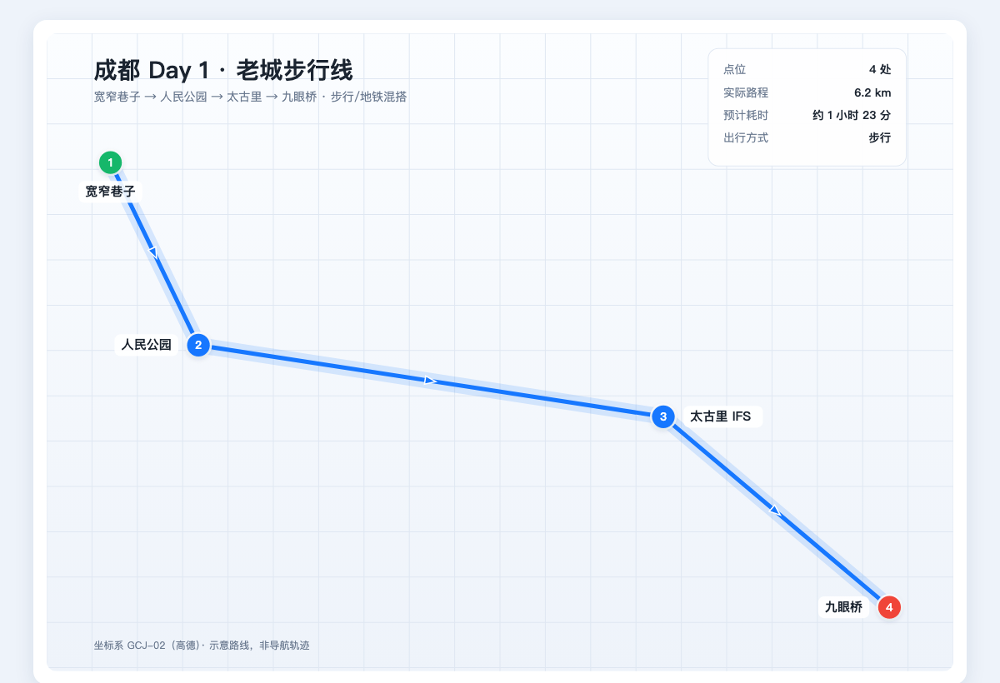

# 旅行攻略助手 · travel-guide

> 说一句「周末去成都玩 3 天」，拿到一份**小时级、可核验、能直接发群里**的攻略。

<p align="center">
  
  
</p>

这不是一个「AI 写游记」的提示词。它是一套**装了刹车的工作流**：旅游攻略最容易出的问题是
票价编造、开放时间记错、路线走回头路、发到群里没人点得开链接。这里用取材分工、证据分级、
机械自查和本地渲染把这几件事逐个堵住。

## 它跟「问 AI 要一份行程」的区别

| 常见做法 | 这里怎么做 |
|---|---|
| 模型凭记忆写票价和开放时间 | **票价 / 开放时间只认 A 级证据**（官方页、地图 API、12306），模型记忆只能负责「哪里值得去」 |
| 一份万能模板，塞进所有城市 | 先读 `偏好/我的偏好.md`，节奏、预算、步行上限、忌口都进约束 |
| 路线图要申请高德 Key | 默认**零 Key**：URI 深链 + 本地自绘 SVG/HTML，能看能导航能发微信 |
| 给一堆小红书链接自己去翻 | 抖音匿名自动抓、小红书登录后低频只读，落成带「采纳了什么」的取材表 |
| 「点这个链接直接跳高德 App」 | 明确不承诺：微信/QQ 内置浏览器唤不起 App，改成地址 + 长图 |
| 交付前靠模型自己检查 | `plan_lint.py --strict` 机械门禁 |

## 一条完整的链路

```
偏好档案 → 取材（抖音 / 小红书 / 官方 / 地图）→ 证据分级 → 逐日排程
        → 路线图 SVG/HTML + 逐跳导航 → 分享长图 + 文案 → 落盘 + 更新索引
```

- **取材三条腿**：平台经验（素人才知道的排队、机位、人均）、官方事实、地图坐标与耗时。
- **证据分级 A/B/C/D**：单源 UGC 只能进「备选 / 听说」，未核实的明确标注。
- **地理聚类 + 强度守恒**：同一天的点尽量落在 3 km 内，带老人小孩每天最多 2 个主景点，每天留一个 Plan B。
- **成品即交付**：`行程.md`（主文档）、`路线图.html`（可点）、`攻略长图.png`（750px 直发微信）、`分享文案.md`。

## 目录

| 路径 | 作用 |
|---|---|
| [索引.md](索引.md) | 总入口，每次做完攻略追加一行 |
| [偏好/我的偏好.md](偏好/我的偏好.md) | 旅行口味档案，决定攻略默认风格 |
| [模板/行程模板.md](模板/行程模板.md) | 输出格式模板 |
| [行程/2026-11-15-成都示例/](行程/2026-11-15-成都示例/) | **端到端示例**，这条流水线的全部产物 |
| [research/](research/) | 工具链实测记录（取材 / 高德 / 分享 / 现成技能） |
| [工具/](工具/) | 取材服务与本机自检 |
| `.dsh/skills/travel-guide/` | 入口技能：取材 + 偏好 + 路线图 + 分享 |
| `.dsh/skills/trip-planner-cn/` | 境内规划内核（MIT，vendored 自 npm `dsh-trip-planner-cn@0.1.2`） |

## 快速开始

### 1. 当成一个工作区用（推荐）

```bash
git clone https://github.com/2022124030jc/travel-guide.git
```

用 DeepSeek Harness 打开这个目录作为工作区——
`.dsh/skills/` 下的两个技能会被自动加载，然后直接说需求：

- "11 月中旬去成都 4 天，两个人，人均 3000，帮我做攻略"
- "周末杭州周边一日游，带爸妈，不要太累"
- "把这份攻略做成图发我微信"

### 2. 只跑脚本

全部脚本**只用 Python 标准库**，3.9+ 即可，无需 pip install：

```bash
python3 工具/doctor.py            # 四条腿自检：抖音 / 小红书服务 / 高德 Key / OSRM

# 出路线图（不需要任何 Key）
python3 .dsh/skills/travel-guide/scripts/amap_route.py \
  --out 路线图.svg --html 路线图.html --links 链接.json --title "成都 3 日"

# JSON → 750px 分享长图
python3 .dsh/skills/travel-guide/scripts/share_card.py 分享卡片.json \
  -o 攻略长图.png --copy --open wechat
```

## 脚本

| 脚本 | 作用 | 依赖 |
|---|---|---|
| `travel-guide/scripts/douyin_pick.py` | 抓抖音 `/shipin/<id>`，出标题 + AI 文稿 | 无 |
| `travel-guide/scripts/xhs_pick.py` | 走本地 xiaohongshu-mcp 服务取小红书笔记 | 需自建服务，见 [工具/README.md](工具/README.md) |
| `travel-guide/scripts/amap_route.py` | SVG/HTML 路线图 + 高德深链（`--live` 走 OSRM 真实路程） | 无 |
| `travel-guide/scripts/share_card.py` | JSON → 分享长图，写剪贴板并唤起微信/QQ | 无 |
| `trip-planner-cn/scripts/plan_lint.py` | 行程机械门禁（`--strict`） | 无 |
| `trip-planner-cn/scripts/*` | HTML 路书、POI、导航、KML | 无 |

## 成品长什么样

```
行程/2026-11-15-成都示例/
├── 行程.md          # 主文档，逐日安排 + Plan B
├── 路线图.html      # 可点击路线 + 逐段导航
├── 路线图.svg       # 静态图
├── 攻略长图.png     # 750×1732，可直接发微信/QQ
├── 分享卡片.json    # 长图源数据，改它就能重出图
└── 链接.json        # 逐段高德链接
```

## 三条硬规则

1. **价格与开放时间只认官方/工具实证**——UGC 只提供排队、避坑、人均、机位这类体验信息。
2. **不提「点开直接跳高德 App」**——微信/QQ 内置浏览器唤不起 App。
3. **不自动发消息**——分享停在「剪贴板 + 唤起 App」，最后由人来选人点发送。

## 隐私与合规

这个仓库里的 `.gitignore` 不是摆设：

- **登录态永不入库**：`工具/xhs-mcp/.home/`（浏览器 profile）、各类 `cookies.json`、`*.log` 全部忽略。
- **API Key 放在工作区外**：高德 Key 存 `~/.dsh/amap/key`（`chmod 600`），目录 `chmod 700`。
- **小红书只做低频只读**：单次 ≤10 篇、页间 ≥3 秒、不建库、不存全文、不发帖不点赞不关注。
  用的是你自己的登录态，平台用户协议禁止自动化采集，风险自负——这条写在这里是为了让后来的人别踩。
- **真实行程不上传**：仓库里只有一份虚构的「成都示例」，个人真实行程留在本地。
- 第三方二进制（xiaohongshu-mcp）不随仓库分发，按 [工具/xhs-mcp/README.md](工具/xhs-mcp/README.md) 自行下载。

## 许可

本项目 MIT，见 [LICENSE](LICENSE)。

`.dsh/skills/trip-planner-cn/` 为 MIT 许可的第三方技能（vendored 自 npm `dsh-trip-planner-cn@0.1.2`），
原始版权见 [.dsh/skills/trip-planner-cn/LICENSE](.dsh/skills/trip-planner-cn/LICENSE) 与
[THIRD-PARTY-NOTICES.md](.dsh/skills/trip-planner-cn/THIRD-PARTY-NOTICES.md)。